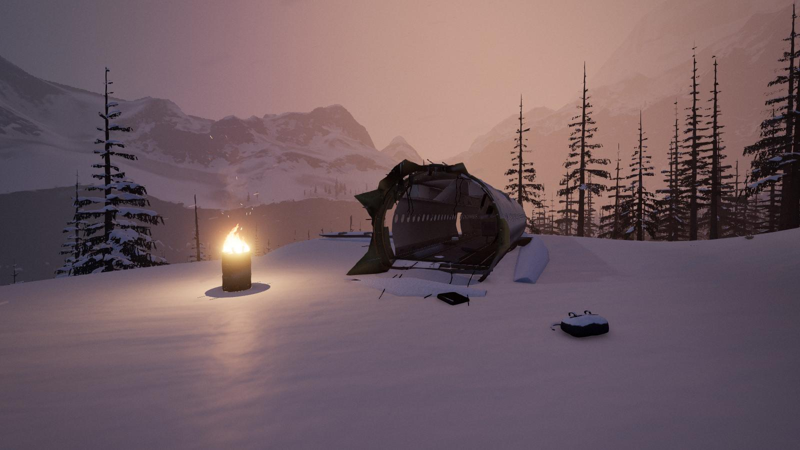
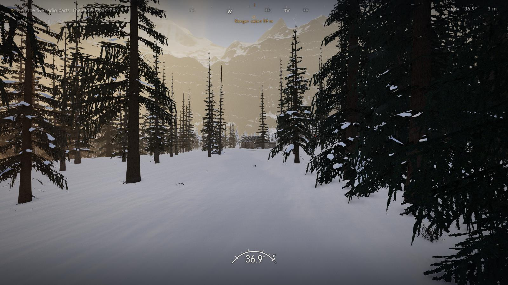
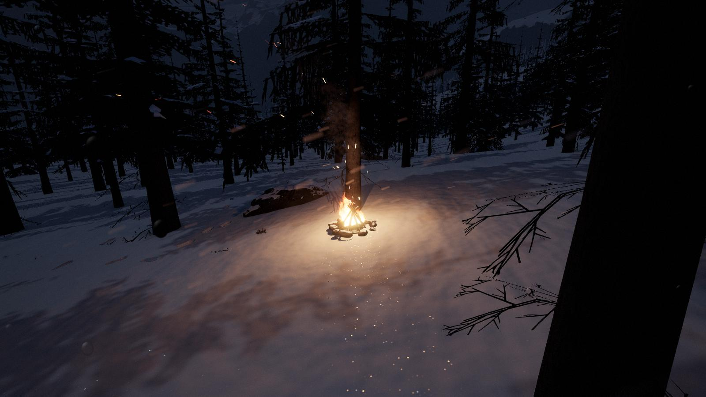
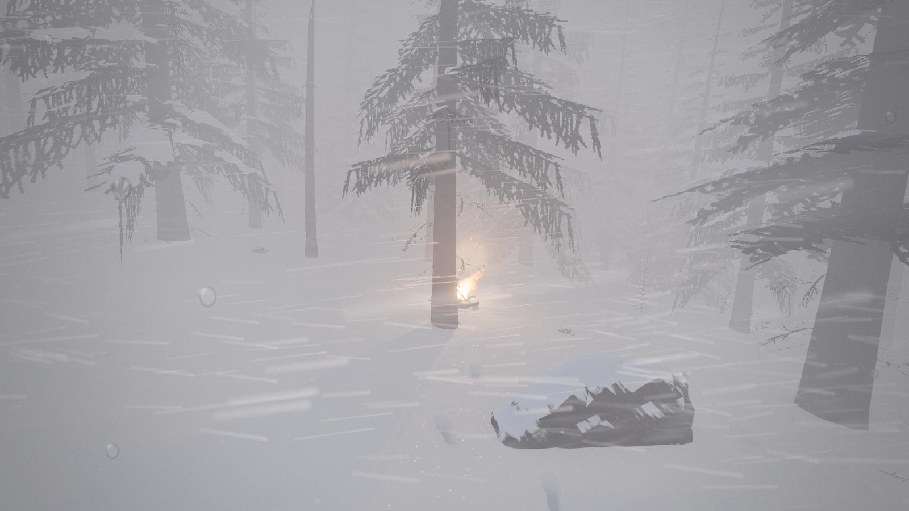
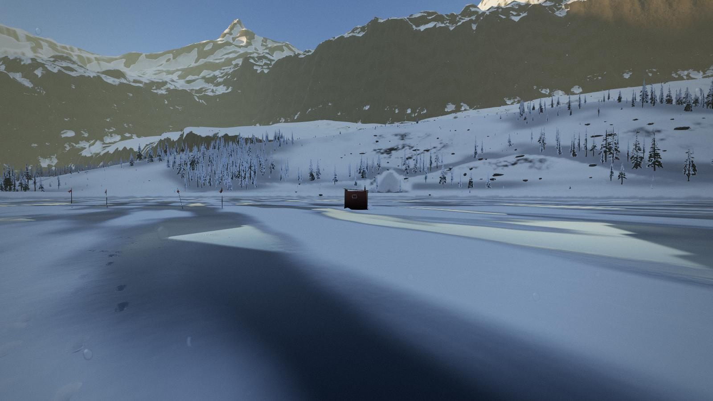
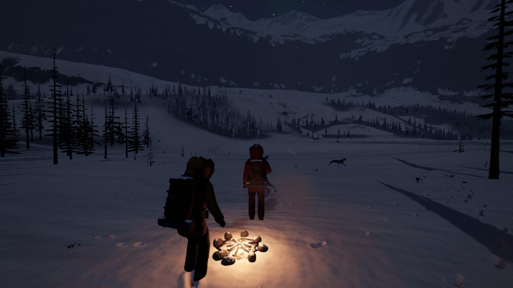
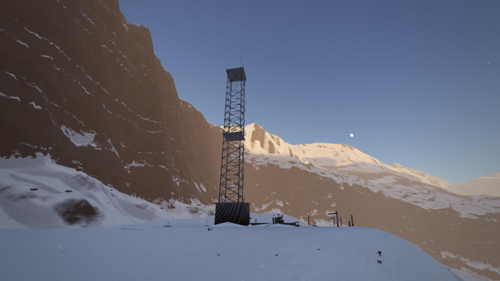
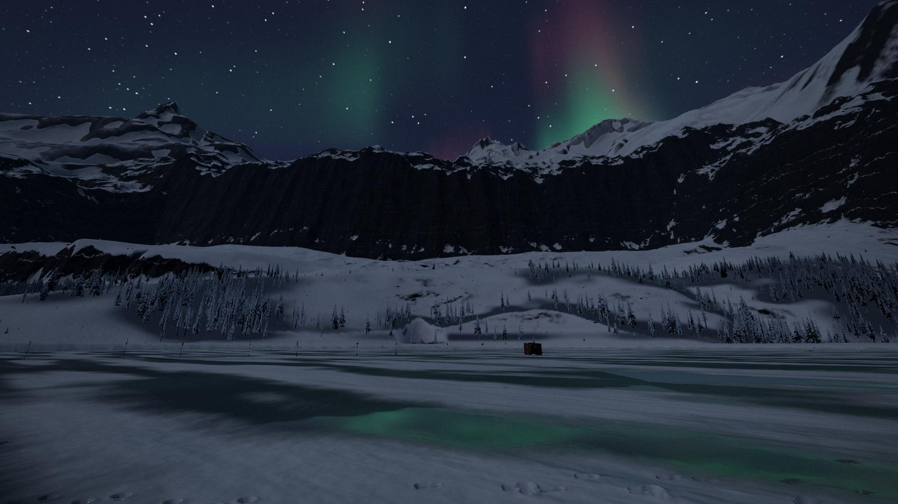

# Cold Signal

**Play it: https://reflex000.github.io/cold-signal/** (a recent Chrome or Edge for WebGPU; other browsers use WebGL 2; phones in landscape)

Flight 417 has come down on the south face of a mountain in a blizzard, an hour before dark. You crawl
out of the broken fuselage into the snow. The emergency radio is dead: its five parts are scattered
over the mountain, in the wreckage and in the places people left behind. Find them, carry them up to
the old signal tower on the north ridge, rebuild the transmitter, crank the generator and hold out
until the helicopter comes.

The cold is the enemy, and the wolves are what the cold sends. Every leg is a bet against the storm:
warm up, go out into the weather, find something, get back to a fire before your body gives out. One
run takes about an hour. It is a first-person survival game, played alone or with up to three
companions, that runs in the browser on WebGPU, or WebGL 2 where WebGPU is missing, on desktops and on
phones. Every mesh, texture, sound and note of music in it is generated in code when it loads.

| | |
|---|---|
|  |  |
|  |  |
|  |  |
|  |  |

## Play

Open the page, choose **New game**. The game starts at dusk inside the wreck; short lines on screen
explain each thing the first time it matters (they can be turned off in Settings). **How to play** in
the menu covers the rest: the cold, fire, wood, wolves, the radio, the weather and playing together.

Companions (Settings, *Companions*, 0 to 3) are bot players who walk with you, build and feed fires,
gather wood, revive you and fight; supplies and wolf packs scale with the size of the group. Everything is
built for two to four people; the network transport that joins real players is the one piece left to
plug in (see *How it is made*).

### Controls

Keyboard and mouse (click the game to capture the mouse):

| Key | Action |
|---|---|
| W A S D or the arrow keys | Move |
| Mouse | Look |
| Shift | Sprint |
| Space | Jump |
| Ctrl or C | Crouch |
| E | Use what you look at (take, open, light, feed, revive, install, crank). Hold for long actions, such as snapping the dead branches off a tree trunk for sticks |
| Left button | Swing the axe, fire, crank the radio |
| Right button | Aim the rifle, raise the flashlight or the radio |
| R | Reload (rifle, flare gun, flashlight cell) |
| F | Flashlight on / off |
| B | Lay a campfire from three sticks |
| G | Drop what is in your hand, put a heavy log down |
| 1 to 5 | Axe, flashlight, flare gun, rifle, radio |
| Q, mouse wheel | Empty hands, next / previous tool |
| Tab | The pack (inventory, fire, map) |
| Esc or M | Pause |

Gamepad (standard mapping):

| Button | Action |
|---|---|
| Left stick | Move; press it to sprint |
| Right stick | Look |
| A | Jump |
| B | Crouch |
| X | Use. Hold for long actions (dead branches off a tree trunk) |
| Y | Reload |
| RT | Swing, fire, crank |
| LT | Aim, raise the light |
| LB / RB | Previous / next tool |
| D-pad up | Flashlight on / off |
| View | The pack (lay a fire from it) |
| Menu | Pause |

Touch (phones and tablets, in landscape): the left thumb moves (the stick appears where you touch),
a drag on the right side looks. The large button swings, fires and cranks (drag on it to keep
looking), the sight button aims, the hand uses what you look at (hold for long actions, such as
snapping the dead branches off a tree trunk), the arrows
jump, crouch and lock sprint, the tool ring changes tools, the small button reloads or switches the
flashlight, and the pack button opens the pack, where a fire is laid.

## Run it

Requires Node.js 22 and a browser with WebGPU (a recent Chrome or Edge) or WebGL 2.

```sh
npm install
npm run dev        # the game at http://127.0.0.1:8940/
npm run build      # the release build in dist/ (relative paths: runs from any sub-path)
npm run preview    # serve dist/ at http://127.0.0.1:8941/
npm run check      # type-check everything
npm test           # the simulation, world, network and UI tests (vitest, no browser)
npm run gpu        # is the headless browser on the real GPU with WebGPU?
```

The play tool drives the real game in headless Chrome on the real GPU and writes JPEGs to `shots/`:

```sh
node tools/play.mjs tools/scenarios/playthrough.mjs                  # the whole hour, autopilot plus a companion
node tools/play.mjs tools/scenarios/playthrough.mjs --backend webgl  # the same on WebGL 2
node tools/play.mjs tools/scenarios/opening.mjs --mobile 1           # the first minutes on a phone viewport
node tools/play.mjs tools/scenarios/tour.mjs --q high                # every place at dusk and in the storm
node tools/play.mjs tools/scenarios/playthrough.mjs --dist 1         # against the production build
node tools/play.mjs tools/scenarios/media.mjs --q high               # the pictures in this README, into media/
node tools/balance.mjs --seeds 417,1,2 --bots 1                      # the hour without a browser, with numbers
```

Options: `--q mobile|low|medium|high|ultra`, `--backend webgpu|webgl`, `--mobile 1` (phone viewport,
touch, WebGL 2), `--w 1600 --h 900`, `--live 1` (real-time loop), `--query "a=b"`. Other tools:
`tools/ui-shots.mjs` (every interface screen), `tools/shot-models.mjs` (models), `tools/world-map.mjs`
(a map of a seed), `tools/audio-check.mjs` and `tools/music-check.mjs` (offline renders and meters).
The pages under `dev/` mount one part of the game alone (sky, terrain, forest, weather, models,
figures, effects, sound, music, interface) at `/dev/<name>.html` on the dev server.

### URL options

| Option | |
|---|---|
| `?seed=417` | The mountain's seed: the ground, the forest, the loot and the weather change; the places stay put |
| `?q=mobile\|low\|medium\|high\|ultra\|auto` | Quality preset (also in Settings) |
| `?webgl=1` | Use the WebGL 2 backend even where WebGPU is available |
| `?bots=0..3` | Companions |
| `?touch=1`, `?touch=0` | Force the touch controls on or off |
| `?skipTitle=1` | Straight into a new game (no title, no opening) |
| `?continue=1` | Straight into the saved game |
| `?wire=json&lag=120&jitter=30` | Serialise every network message and delay it (the multiplayer path, in one page) |
| `?dev=1` | Developer hooks: `window.CS`, debug actions, V for the third-person view |
| `?still=1` | No real-time loop; the `CS` hook steps the game (the tools) |
| `?nosave=1`, `?fresh=1` | Never touch the save; ignore stored settings |
| `?real=terrain,sky,weather,forest\|all\|none` | Which real graphics systems replace their simple stand-ins |
| `?gpu=1`, `?gpu=gl` | Measure GPU time per frame (`CS.stats().gpuMs`) |

## How it is made

**Everything is code.** There are no image, model, audio or font files. Textures are drawn on canvases,
filled into data textures or computed in shaders; models are built by a small toolkit; sounds and
music are synthesized with the Web Audio API.

**Rendering.** three.js r187 with `WebGPURenderer`, which runs on WebGPU and falls back to WebGL 2;
every material is a TSL node material, so one shader source serves both. The terrain is a continuous
level-of-detail mesh over 12 km with a procedural snow, rock and ice material (wind crust, sastrugi,
sparkle at grazing angles, blue light in the shade) and deformable snow: footprints, paw tracks, drag
marks and body hollows that fill in again as the snow falls. The sky is computed from Rayleigh, Mie and
ozone scattering tables, with the sun and moon placed by the clock, stars, a cloud deck and the aurora.
The storm is a volume: height fog, a ray-marched storm layer on WebGPU, screen-space veils on WebGL 2
and phones, and streaming snow. The forest is 32,000 spruce, fir and dead trees in eight shapes each,
bending in the wind, with impostors baked at load for the distance. Figures are animated procedurally
(two-bone IK, planted feet) and skinned in the vertex shader from one shared bone texture. Post: ground
truth ambient occlusion, bloom, ACES tone mapping, anti-aliasing, frost and melt drops on the goggles,
film grain. Five quality presets from phone to 4K, with dynamic resolution.

**The world** is a pure function of the seed: an eroded heightmap, seven places levelled into it, the
trail between them, trees, rocks, dead wood and supplies scattered by rule, the frozen lake with its
thin ice. Walls and floors come from shared blueprints, so the walls you see are the walls you hit.

**The simulation** is plain JSON (`SimState`) advanced at a fixed 30 ticks a second by thirteen systems:
the spawn table, weather and clock, movement, lake ice, wood, items, tools, fire, body temperature, wolves, the
objective, vitals, the story. It has no wall clock and no `Math.random`: the same commands give the
same game. Body temperature is the main threat: air temperature, wind chill, shelter, wet clothes,
exertion, fire and huddling all move it, calibrated so that an exposed body goes from healthy to
freezing in four to five minutes in a full storm and a good fire brings it back in about two.

**Multiplayer-ready.** Single-player already runs the network path: an authoritative host and a client
session in one page, joined by a loopback transport. The client predicts its own player with the same
movement function the host runs and reconciles on acknowledgement; everything else is interpolated
about 100 ms in the past; snapshots carry moving things every tick and the rest when it changes (about
7 KB for four players and sixteen wolves). Companion bots play through exactly the same commands as a
person. A save is the simulation state as JSON. A real transport (WebRTC or WebSocket) is one more
class: see [docs/NETWORK.md](docs/NETWORK.md).

**Sound and music.** Wind is the bed: it rises with the storm, hides behind walls and roars on the
ridge. Footsteps change with the surface, the fire crackles and pops, the body shivers and coughs as it cools,
the ice creaks under load, wolves howl from across the valley. The score is written in a plain text
notation and played by synthesized instruments (cello, felt piano, bowed glass, frame drum, ice
harmonics, muted brass) through a generated cold reverb; its moods follow the game.

## Code

```
index.html, src/main.ts   the page and the boot
src/core/                 seeded random numbers, noise, maths, the event bus
src/world/                the mountain from a seed: terrain, places, trail, scatter, colliders, blueprints
src/sim/                  the simulation: state, systems (one file each), movement, tests
src/net/                  host, client session (prediction, interpolation), loopback transport
src/game/                 the client: input, camera, focus, HUD model and hints, bots, saving, the main loop
src/gfx/                  renderer, quality, post; sky/ weather/ terrain/ snow/ forest/ fx/
src/models/               the model toolkit, the shared prop material, every prop and structure
src/actors/               the player figure, the wolf, first-person hands and tools
src/audio/                the sound engine, effects, ambience, the score and its instruments
src/ui/                   every screen and the touch controls (DOM and CSS)
dev/                      bench pages, one per part
tools/                    headless browser tools, scenarios, the balance runner
docs/                     the design (DESIGN.md), networking, three.js notes, module notes
```

`docs/DESIGN.md` holds the design, the art direction and the module contracts.

## Credits and licence

Built on [three.js](https://threejs.org/) (MIT licence, copyright the three.js authors); the release
build carries its licence in `dist/THIRD-PARTY-LICENSES.md`. Built with TypeScript and Vite; tested with
Vitest and Playwright.

Cold Signal is released under the MIT licence: see [LICENSE](LICENSE).
